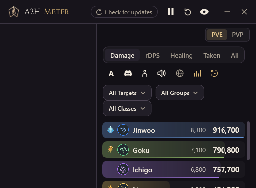
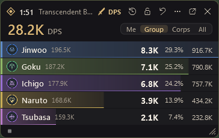
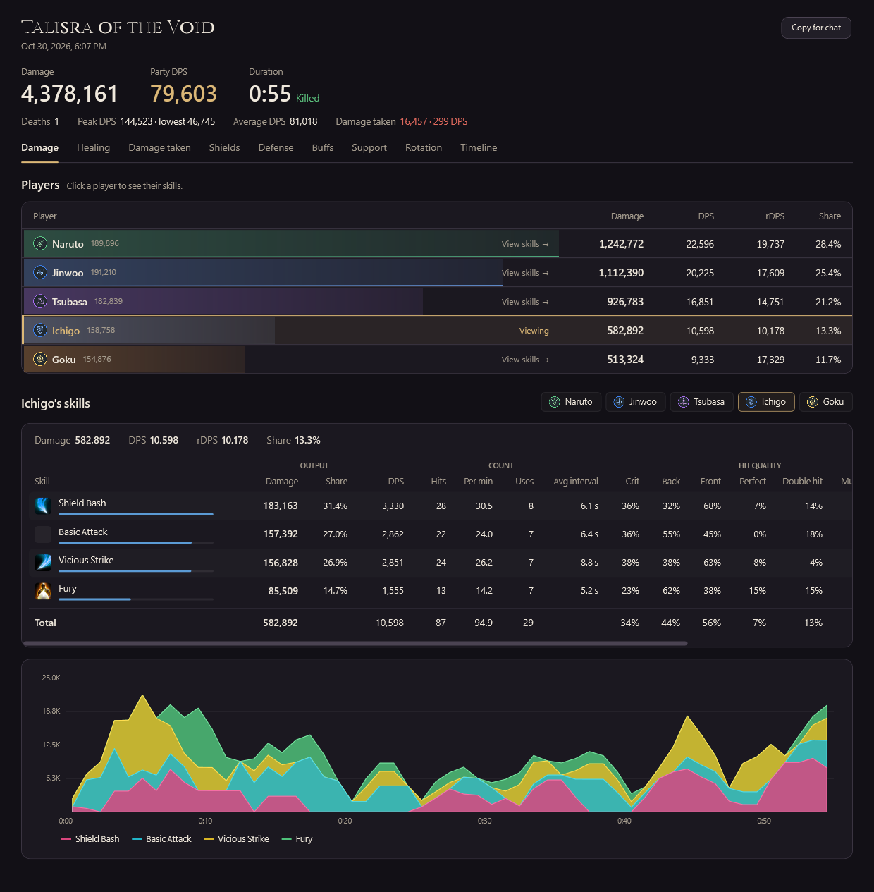
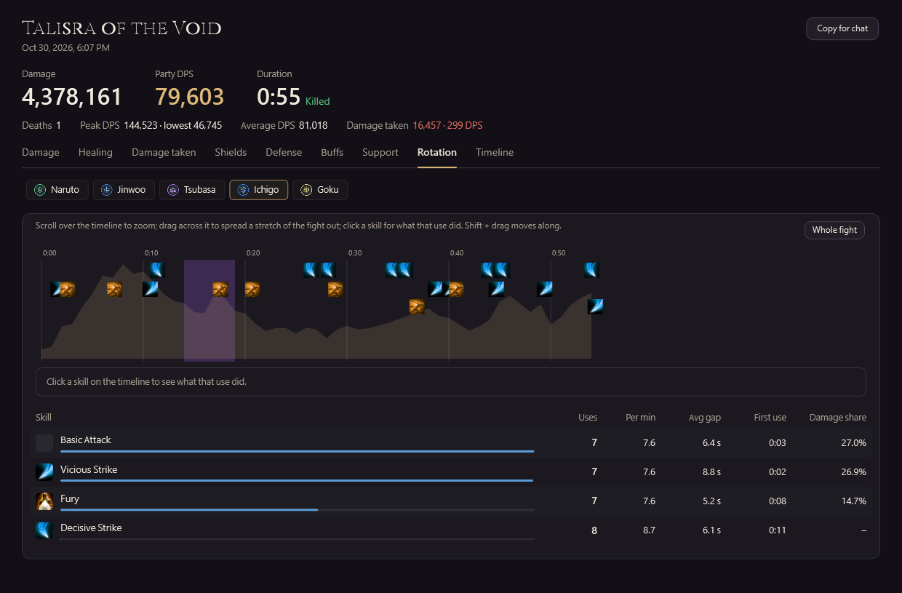
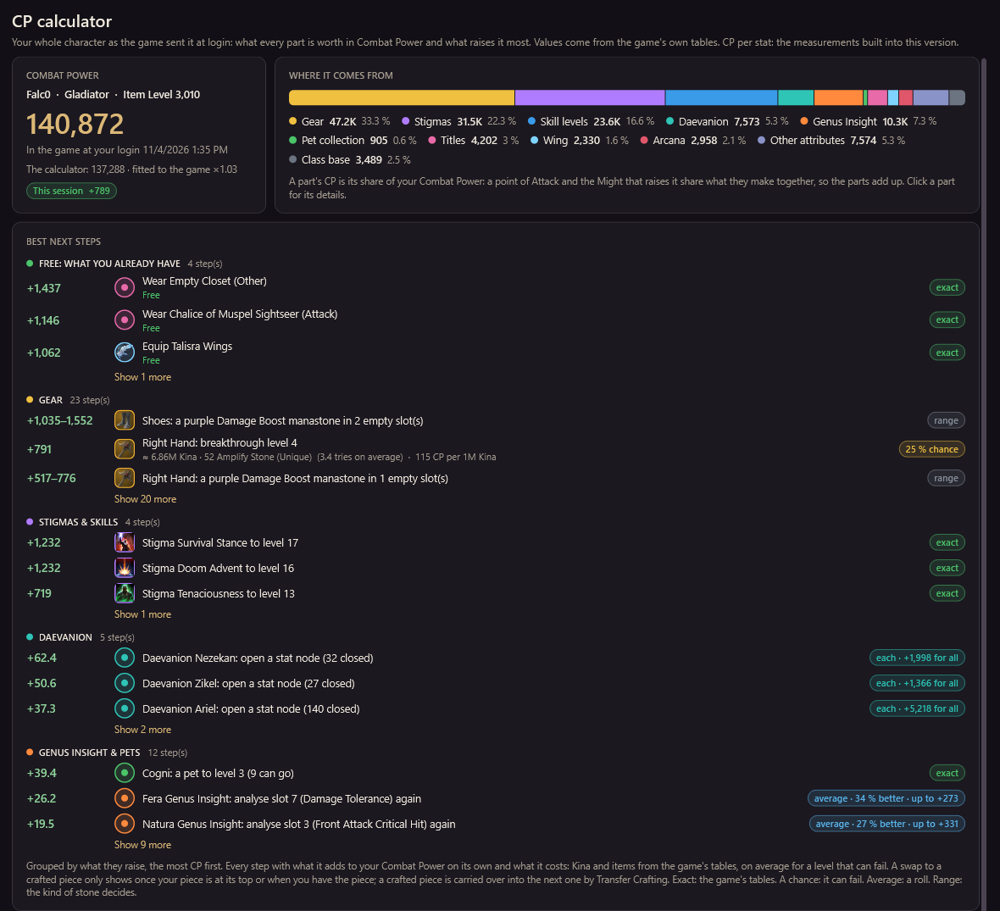
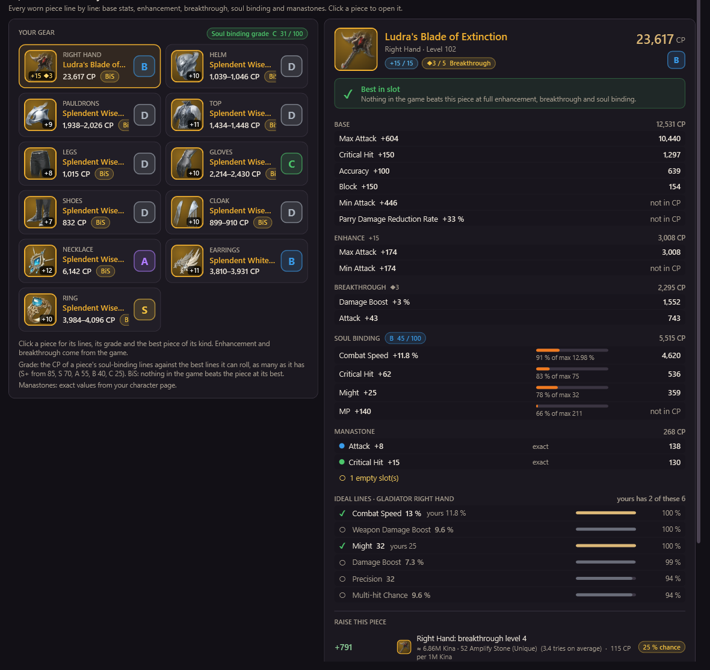
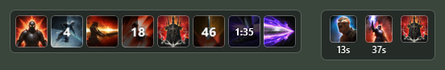
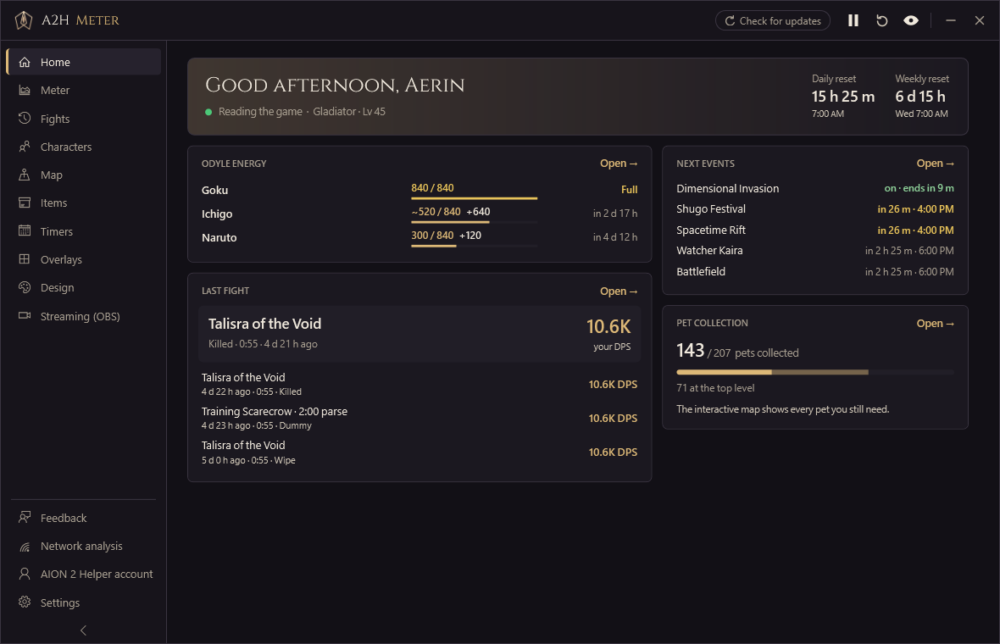
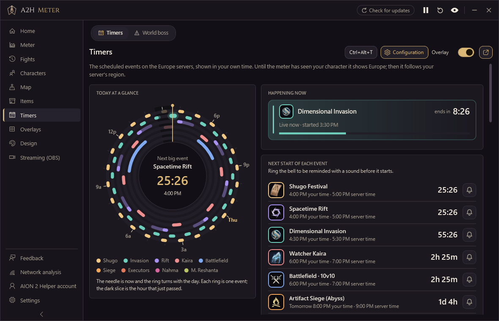
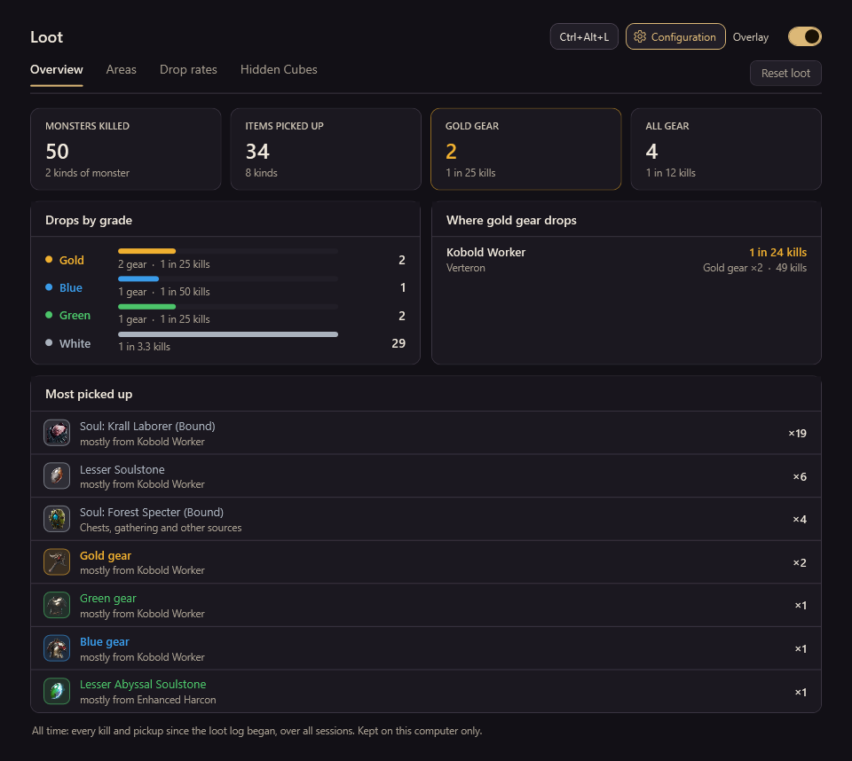

# A2HMeter

A damage and healing meter for **AION 2**, made for [aion2helper.com](https://aion2helper.com) and its Discord.

  
  

## What it does

**Meter**
- Live DPS, healing and damage taken for you, your group, your corps or everyone around, in PvE and PvP
- rDPS: each player's damage with what their buffs added to the others
- Filter by target, group and class; one click shows a player's skills
- Boss fights count the boss and its adds, not the monsters around it; the fight clock shows the boss's enrage time, and a wipe never counts into the next pull

**Overlays** (click-through, shown only while the game is in front)
- A compact meter, boss health and casts, event timers, skill cooldowns and the effects on you, the pet farm
- Each one placed, scaled and locked on its own; several looks to choose from

**Fight reports**
- Damage, healing, damage taken, shields, defense, buffs, support and a rotation timeline for every player
- Per skill: hits, crits, back and front attacks, perfect, double and multi hits
- A summary to copy into chat, and the History of every boss fight, Nightmare run and training-dummy parse on this PC with your bests
- Upload a boss fight to aion2helper.com, public or private, and share it in Discord (only when you choose to)

**CP calculator**
- Your whole Combat Power by source: gear line by line, Stigmas, skills, Daevanion, Genus Insight, pets, titles, wings, Arcana
- The best next steps, grouped and ranked, each with its Kina and material cost
- For every piece: its soul-binding lines (skill lines too), the six ideal lines for your class on that slot, and the best piece of its kind for your race

**Skill Assist**
- Your cooldowns as a skill bar: every skill in its place, a sweep and a countdown that only goes down; basic attacks are left out
- The effects on you, each with its time left

**Your characters and the world**
- Every character's Odyle energy, daily and weekly counters, season missions, supply requests and inventory
- The event timetable and field bosses in your own time, with a sound before they start
- An interactive map with your pet collection route, gathering spots and Hidden Cubes
- Loot: what dropped where, drop rates per monster and what your cubes gave
- An OBS source for streaming, a check of your connection to the game, and hotkeys to open its pages and overlays

  
  

  
  

  

  
  

  

The pictures are made by the app's own checks with made-up players and fights.

## How it works

It reads the game's own network traffic on your PC through the [Npcap](https://npcap.com) driver, passively: it never sends a
packet to the game, never reads or changes the game's memory or files, and needs no administrator rights. To tell when one of the
game's menus is open and, for the cube finder, to read your place on the minimap, it asks Windows for a picture of the game window
a few times a second (PrintWindow); the picture stays in memory and is never saved or sent. Nothing about your play leaves your PC
unless you upload it.

NCSOFT has not approved this or any other damage meter. Use it at your own responsibility and check the game's rules.

## Install

1. Install [Npcap](https://npcap.com) (keep its default options).
2. Download the installer from the [latest release](../../releases/latest) and run it.

Updates install themselves from this repository's full releases.

## License

Copyright (c) 2026 AION 2 Helper. All rights reserved: you may install and use the app, but the source code may not be copied,
changed or reused without permission. See [LICENSE](LICENSE). Parts that come from other projects keep their own licenses:
see [THIRD-PARTY-NOTICES.md](THIRD-PARTY-NOTICES.md).
