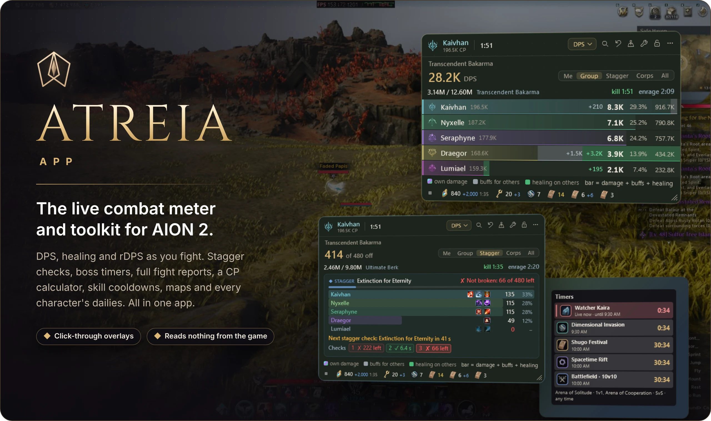
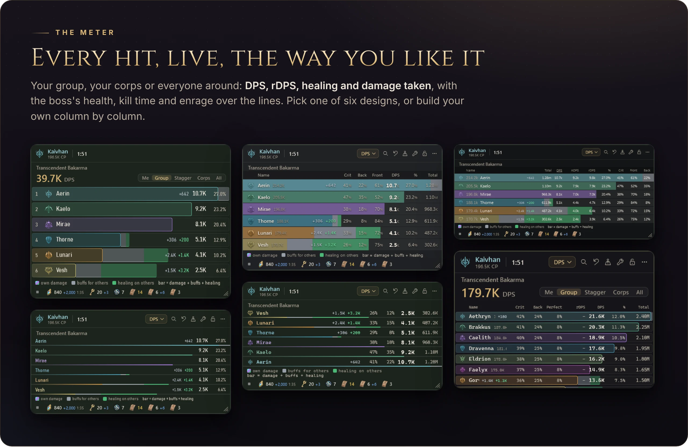
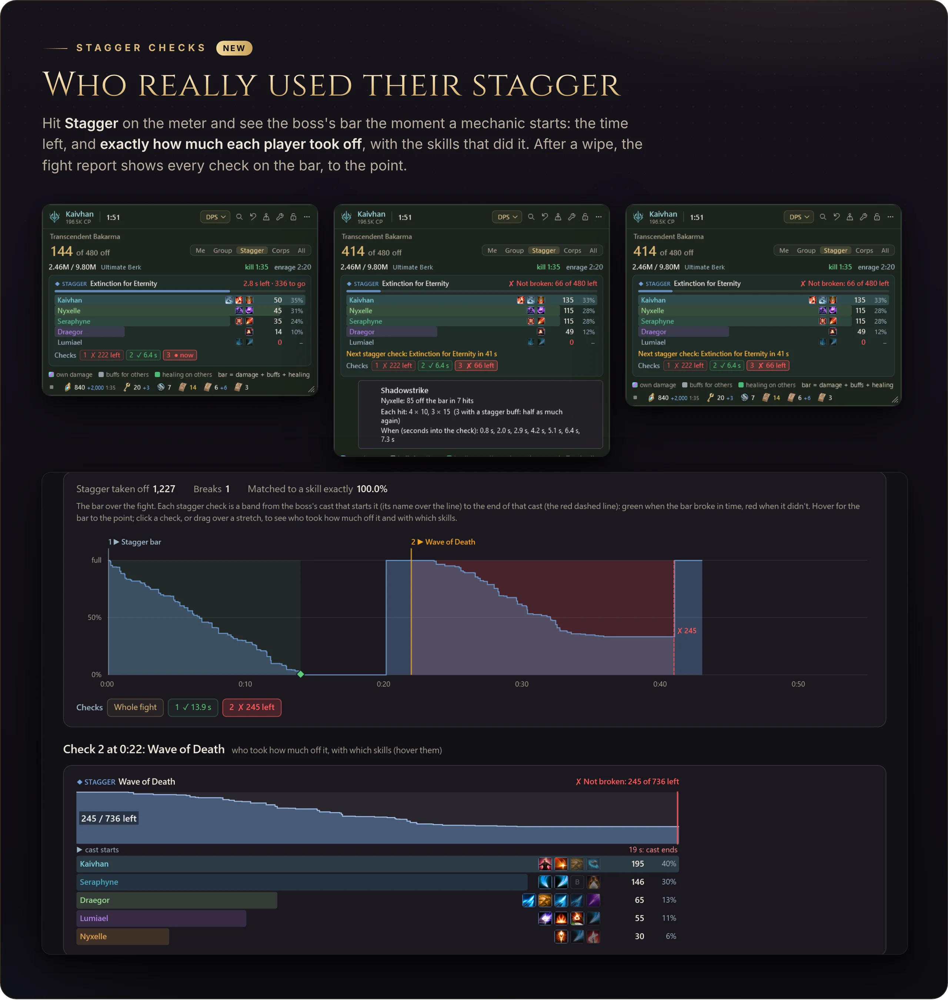
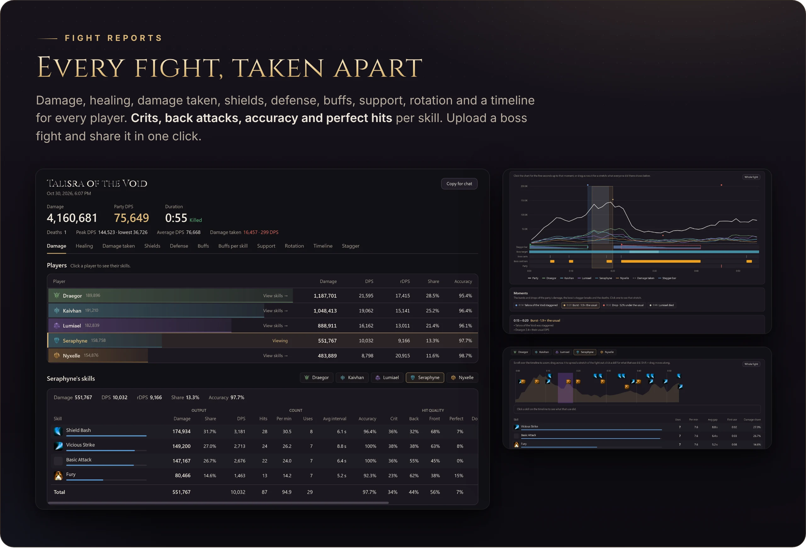
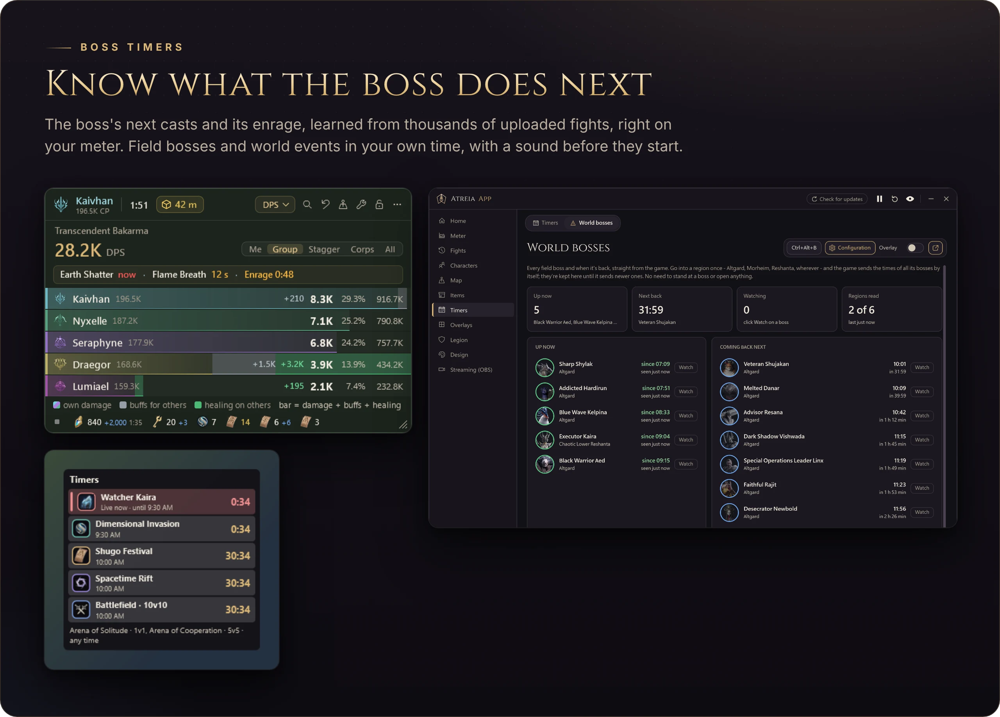
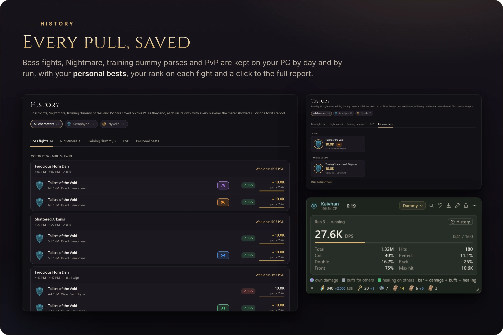
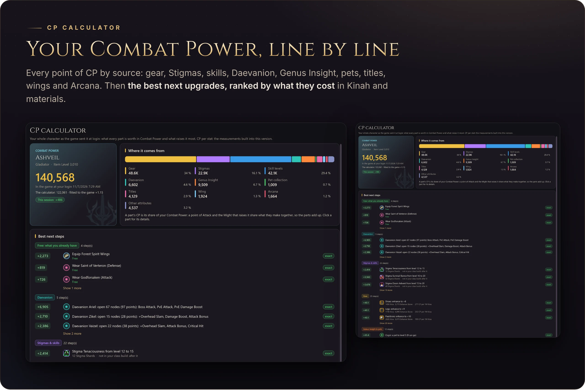
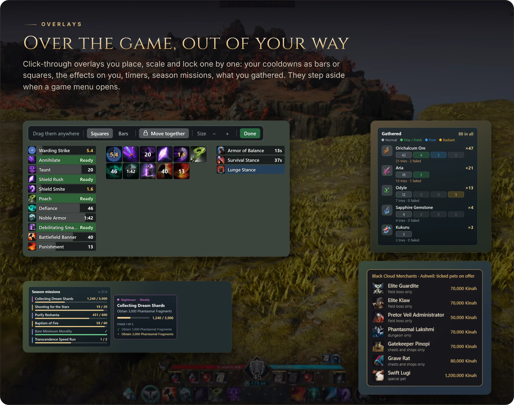
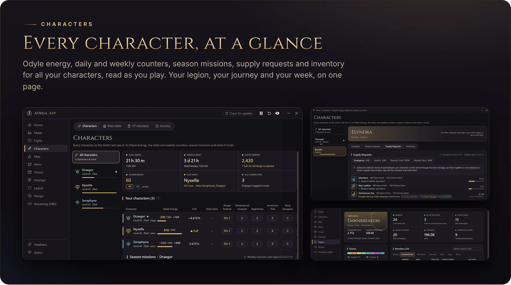
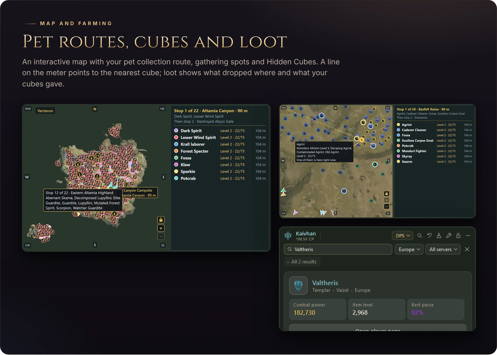

  

  

  <a href="https://atreia.app"><b>atreia.app</b></a>
  &nbsp;·&nbsp;
  <a href="#install">Install</a>
  &nbsp;·&nbsp;
  <a href="#how-it-works">How it works</a>
  &nbsp;·&nbsp;
  <a href="../../releases">What's new</a>

 

<table>
  <tr>
    <td width="33%" valign="top"><b>Live meter</b> DPS, rDPS, healing and damage taken for you, your group, your corps or everyone, in PvE and PvP</td>
    <td width="33%" valign="top"><b>Stagger checks</b> Who took how much off the boss's stagger bar, with which skills, the moment a mechanic starts</td>
    <td width="33%" valign="top"><b>Fight reports</b> Every player and skill taken apart, a timeline, rotation, buffs, accuracy, and one-click sharing</td>
  </tr>
  <tr>
    <td valign="top"><b>Boss timers</b> The boss's next casts and its enrage on your meter, field bosses and events in your own time</td>
    <td valign="top"><b>CP calculator</b> Your Combat Power by source, and the cheapest upgrades ranked</td>
    <td valign="top"><b>Overlays</b> Cooldowns, effects, timers, season missions and gathering, placed anywhere, click-through</td>
  </tr>
  <tr>
    <td valign="top"><b>History and bests</b> Every boss pull, Nightmare run and dummy parse kept on your PC, with your personal bests</td>
    <td valign="top"><b>Characters</b> Odyle energy, dailies, weeklies, season missions, supply requests and inventory for all of them</td>
    <td valign="top"><b>Map and loot</b> Pet routes, gathering spots, Hidden Cubes and what dropped where</td>
  </tr>
</table>

 

- Your group, your corps or everyone around, with one click to a player's skills
- **rDPS**: each player's damage with what their buffs added to the others
- The boss's health, the time to kill it at your pace and its enrage, over the lines; a wipe never counts into the next pull
- Six designs to start from, then every column, colour and size your own

 

- **Stagger** on the meter's switch shows the boss's check live: the mechanic, the time left, every player's exact amount, 0 for the ones who did nothing
- Hover a skill for each hit, the stagger-buff hits and when they landed
- The fight report draws the bar over the whole fight with each mechanic's start and end; click a check or drag over any stretch

 

- Damage, healing, damage taken, shields, defense, buffs, buffs per skill, support, rotation, timeline and stagger, for every player
- Per skill: hits, uses, crits, back and front attacks, perfect, double and multi hits, and **accuracy**
- A summary to copy into chat; upload a boss fight to atreia.app, public or private, only when you choose to

 

 

 

- Gear line by line, Stigmas, skills, Daevanion, Genus Insight, pets, titles, wings and Arcana
- For every piece: its soul-binding lines, the six ideal lines for your class on that slot, and the best piece of its kind

 

- **Skill Assist**: every skill of your bar as a bar or a square, dragged anywhere; a voice that tells you a skill is back
- Each overlay placed, scaled and locked on its own; all of them hide while a game menu is open

 

 

- Find any player and open their page: gear, stats and best parses
- An OBS source for streaming, a check of your connection to the game, and hotkeys for every page and overlay

The pictures are drawn by the app's own checks with made-up players and fights.

 

## How it works

It reads the game's own network traffic on your PC through the [Npcap](https://npcap.com) driver, passively: it never sends a
packet to the game, never reads or changes the game's memory or files, and needs no administrator rights. To tell when one of the
game's menus is open and, for the cube finder, to read your place on the minimap, it asks Windows for a picture of the game window
a few times a second (PrintWindow); the picture stays in memory and is never saved or sent. Nothing about your play leaves your PC
unless you upload it.

NCSOFT has not approved this or any other damage meter. Use it at your own responsibility and check the game's rules.

## Install

1. Install [Npcap](https://npcap.com) (keep its default options).
2. Download the installer from the [latest release](../../releases/latest) and run it.

Updates install themselves from this repository's releases.

## License

Copyright (c) 2026 Atreia. All rights reserved: you may install and use the app, but the source code may not be copied,
changed or reused without permission. See [LICENSE](LICENSE). Parts that come from other projects keep their own licenses:
see [THIRD-PARTY-NOTICES.md](THIRD-PARTY-NOTICES.md).
